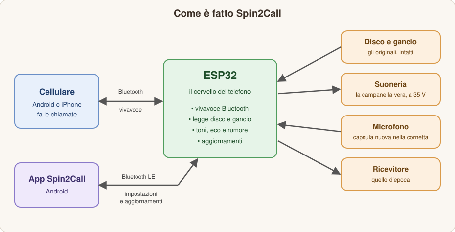

<h1 align="center">☎️ Spin2Call</h1>

  <b>Il telefono a disco di casa, di nuovo al lavoro: collegato al tuo cellulare via Bluetooth.</b> 
  Componi col disco, squilla la campanella vera, parli dalla cornetta originale.

  
  
  
  
  

---

## 📥 Scarica

| | |
|---|---|
| 📱 **App Android** | [Scarica l'APK dall'ultima versione](https://github.com/Silver20000/Spin2Call/releases/latest) (file `spin2call.apk`) |
| 🔄 **Firmware** | Si aggiorna dall'app via Bluetooth: scheda *Aggiornamenti* |

## ✨ Cosa fa

- **Si compone col disco.** Alzi la cornetta, senti il tono di centrale SIP, giri il disco: qualche secondo dopo l'ultima cifra il cellulare chiama.
- **Squilla la campanella vera.** Quando ti chiamano suona la suoneria originale del telefono, con la cadenza italiana (o americana, o inglese).
- **Si parla dalla cornetta originale.** La capsula del ricevitore è quella d'epoca; il microfono è nuovo, con soppressione dell'eco e del rumore.
- **Numeri brevi.** Una cifra sola chiama i preferiti salvati dall'app; lo 0 apre l'assistente vocale.
- **Fuori resta intatto.** Nessun foro, nessun cavo in più: l'elettronica sta nella base.
- **Si aggiorna da solo.** App e firmware si aggiornano dal telefono via Bluetooth; se qualcosa va storto torna la versione precedente.

## 🔌 Come funziona

  

Dentro la base del telefono c'è un **ESP32**, che si presenta al cellulare come un **auricolare Bluetooth** (profilo vivavoce). Il cellulare fa le chiamate; Spin2Call fa il resto:

- **Il disco** viene letto come ai tempi della centrale: il programma conta gli impulsi di ogni cifra, e qualche secondo dopo l'ultima (l'attesa si regola dall'app) chiama il numero composto.
- **I toni** (centrale, occupato) sono generati in casa, con le cadenze del telefono vero.
- **La voce** passa a 8 kHz, la banda del telefono d'epoca. L'**eco** del ricevitore nel microfono viene soppressa, e un **noise gate** abbassa il microfono quando nessuno parla.
- **La campanella** originale si pilota a 35 V e 25 Hz, per far battere il martelletto come quando chiamava la centrale.
- **L'app Android** parla con il telefono via Bluetooth LE, per le impostazioni e gli aggiornamenti.

## 🧰 Dentro la base

| Parte | Com'è |
|---|---|
| **Cervello** | ESP32-WROOM-32E, programmato con ESP-IDF |
| **Ricevitore** | quello originale, pilotato da un amplificatore |
| **Microfono** | capsula electret nuova, con preamplificatore nella cornetta e controllo automatico del guadagno |
| **Suoneria** | la campana originale, con un convertitore a 35 V e un ponte H |
| **Disco e gancio** | gli originali, letti direttamente |
| **Cordone** | l'originale a tre fili: la cornetta resta quella di una volta |

Pensato per il **Siemens S62** della SIP (il "Bigrigio"), ma il progetto è adattabile ad altri telefoni a disco.

## 📱 L'app

| Scheda | Cosa trovi |
|---|---|
| **Stato** | Cosa sta facendo il telefono, cellulare collegato, cornetta, ultimo numero |
| **Rubrica** | I numeri brevi 1-9 e 0, anche presi dai contatti |
| **Impostazioni** | Volume, microfono, suoneria e cadenza, attesa prima della chiamata, tono di centrale |
| **Aggiornamenti** | Firmware del telefono e app |

## 🔧 Primo utilizzo

1. Installa `spin2call.apk` sul telefono Android.
2. Nelle impostazioni Bluetooth del cellulare abbina **Spin2Call** come auricolare (PIN `0000` se lo chiede).
3. Apri l'app: trova il telefono da sola. Dalla scheda *Rubrica* imposta i numeri brevi.

## ❓ Domande frequenti

**Funziona con qualsiasi cellulare?**
Con tutti quelli che supportano il Bluetooth vivavoce (profilo HFP), cioè praticamente tutti. L'app per le impostazioni e gli aggiornamenti è per **Android**.

**Serve aprire il telefono o fare dei fori?**
No: l'elettronica sta nella base, e il telefono resta com'era.

**Cosa succede se un aggiornamento va male?**
Se il firmware nuovo non parte, il telefono torna da solo alla versione precedente.

## 🚧 Stato del progetto

Spin2Call è un progetto personale in sviluppo: oggi alla **versione 0.1.0**, la prima. Le novità sono nel [CHANGELOG](CHANGELOG.md).

## 📜 Novità

Tutti i dettagli nel [CHANGELOG](CHANGELOG.md).

---

Spin2Call © 2026 Silver20000 · <a href="LICENSE">Licenza proprietaria</a>

